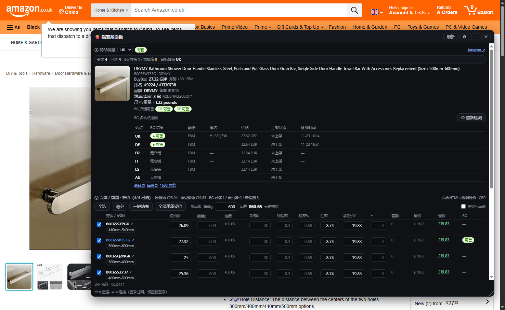
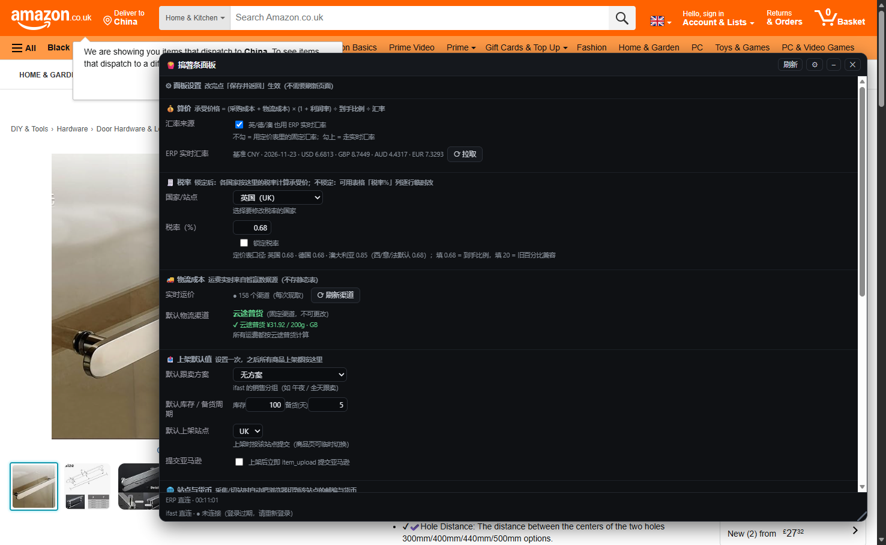
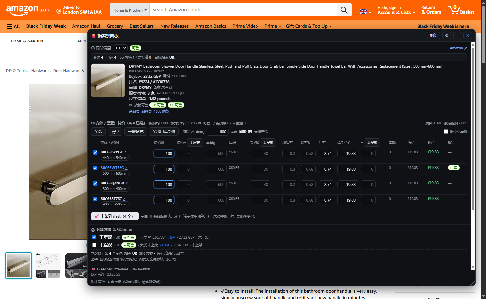
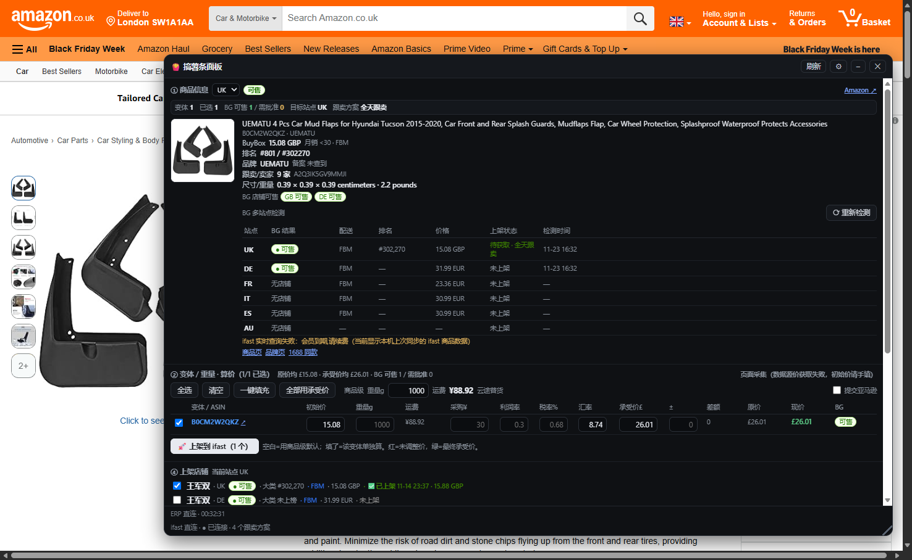

# 搞薯条 · 智赢ERP（zying-erp）for DeepSeek Harness

亚马逊选品 / 跟卖 / 上架一体化工作台，DSH 插件 + 浏览器扩展双端：

- **DSH 插件**：11 个 `zying_*` 工具 + 四个界面页签（采集面板 / 商品管理 / 知产查重 / 选品归档）
- **ERP 后端**：本机 `127.0.0.1:3088`，采集编排、商品库、BG 多站点检测、算价、ifast 上架、运费报价、授权
- **浏览器扩展**：亚马逊商品页 🍟 面板（多站点 BG·排名·配送·价格·上架状态 / 变体算价 / ifast）+ 列表页采集条

> 安装步骤见 **[INSTALL-AGENT.md](INSTALL-AGENT.md)**（给 AI 与人看的逐步说明）。
> 本仓库包含**整套系统全部源码**：插件、ERP 后端、浏览器扩展、完整文档。

## 截图

| 商品页多站点 BG / 价格 / 上架状态 | 面板内置设置（含税率） |
|---|---|
|  |  |

| 初始价逐行锁定 | ifast 上架状态 |
|---|---|
|  |  |

## 功能一览

| 模块 | 能力 |
|---|---|
| 采集 | 多链接（店铺/搜索/类目/榜单/商品页）、全流程采集（网页→数据源基础信息→规则过滤→全店 BG→只保留可售）、商品跟卖、批量跟卖、批量品牌、列表页直采、类目搜索 |
| 商品库 | 统一筛选、可售状态（任意站点可售即算可售）、分店铺 BG、排名/配送/价格、导出 Excel |
| BG | 多站点（UK/DE/FR/IT/ES/AU）按店铺检测，面板表格与商品库同步 |
| 算价 | FBA/FBM/AMZ 利润测算、按站点税率/汇率/本币调整、逐字段锁定、低价与承受价对比 |
| 上架 | ifast 直连（登录/站点/跟卖方案/上架/在架查询）、重复上架拦截、上架台账、回收站 |
| 其他 | 商标查重、蓝海词、找货源以图搜图、实时运费报价、授权（设备指纹 license.key）|

## 目录结构

```
.
├── index.js                # DSH 插件入口（工具注册 + /api/zying-proxy + 自动拉起 ERP）
├── lib/
│   ├── client.js           # DSH 界面（4 个页签）
│   └── erp-launcher.js     # 用 Electron 以 Node 模式启动 erp/server.js 3088
├── erp/                    # ERP 后端（server.js 等 32 个模块）
├── extension/              # 浏览器扩展（Edge/Chrome MV3，加载这个目录）
├── docs/                   # 架构/设计/前端/操作/接口/数据字典/踩坑
├── assets/screenshots/     # 市场截图
├── INSTALL-AGENT.md        # 安装与验收（AI 可执行）
├── package.json
└── cordis.patch.yml
```

## 快速安装（简述）

```powershell
# 1) 用插件市场安装（推荐）
#    DSH → 插件 → 插件市场 → 搜索「搞薯条 / 智赢ERP」→ 安装

# 2) 或命令行
dsh plugin --profile web add "https://github.com/chensuqi631-max/zying-erp/releases/download/v1.3.0/zying-erp-1.3.0.tgz"

# 3) 重启 DSH（完全退出再打开）→ ERP 自动在 3088 启动
Invoke-RestMethod http://127.0.0.1:3088/api/health   # ok=true

# 4) 放授权文件 license.key（向作者申请，绑定设备指纹）
Invoke-RestMethod http://127.0.0.1:3088/api/license/status

# 5) 登录智赢账号（面板 ⚙ → 👤 智赢账号管理，或 /api/zy/login）

# 6) 加载浏览器扩展：edge://extensions → 开发人员模式 → 加载解压缩 → 选 extension/
```

完整步骤、验收命令、排错见 [INSTALL-AGENT.md](INSTALL-AGENT.md)。

## 运行要求

- Windows 10/11 x64，DeepSeek Harness 桌面端
- 采集浏览器：Edge 以 `--remote-debugging-port=9222` 启动（headed，**不要 headless**）
- 授权：`%USERPROFILE%\.zying-erp\data\license.key`（Ed25519，设备指纹绑定）
- 智赢账号：面板内登录后写 token（`%USERPROFILE%\.zying-erp\data\zy-tokens.json`）
- 数据目录：`%USERPROFILE%\.zying-erp\data`（商品库/台账/规则/回收站，备份就拷它）

## 许可

商业授权软件：可安装、可启动，但未获 `license.key` 时所有数据接口返回 403。授权请联系作者。
